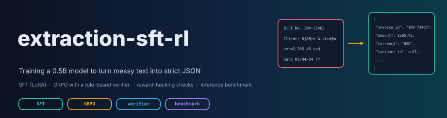
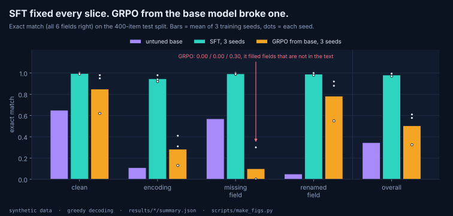
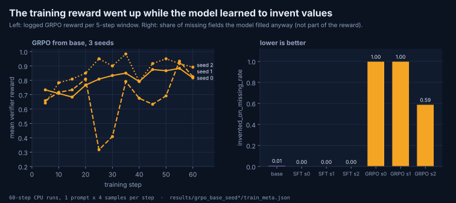
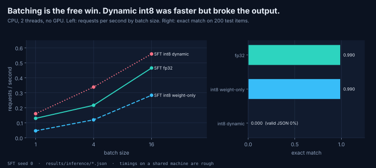
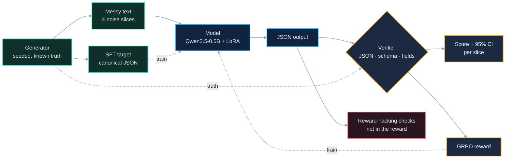

# extraction-sft-rl


Training a small open model (Qwen2.5-0.5B-Instruct, Apache-2.0) to turn messy customer
text into a fixed JSON schema, with **SFT (LoRA)**, **RL (GRPO) using a rule-based
verifier as the reward**, and an **inference benchmark** (quantization, batching,
latency, memory).

> **Scope, read first.** All data in this repo is **synthetic**, generated with known
> ground truth. Nothing here was used with real customers or in production. Every number
> below comes from a real run whose raw output is committed under `results/`
> (`results/RESULTS.md` is generated from those files by `scripts/make_report.py`).
> The committed runs are **small, CPU-only runs** (2 CPU threads, no GPU), so step counts
> are small. The scripts are written to use a GPU when one is present, but **I have not
> tested the GPU path**.

---

## Why I built this

My earlier projects cover evaluation, RL environments and verifiers, but none of them
trained a language model. I wanted one narrow, checkable task where I could own the whole
loop: define the contract, generate data with known answers, grade automatically, train
with SFT and RL, check whether the model is gaming the reward, and measure what it costs
to serve.

The task is structured extraction: an invoice-like message (free text, an email, or a
`key=value` export line) goes in, and a JSON object with exactly 6 fields comes out:
`invoice_id, date (YYYY-MM-DD), amount (number), currency (ISO code), customer_id, customer_name`.
A field that is not in the text must be `null`.

---

## Results at a glance

Test split: 400 synthetic items (100 per noise slice), greedy decoding.
"Exact match" = all 6 fields correct. Brackets = 95% bootstrap CI.

| model | exact match | field score | clean | encoding | missing field | renamed field |
|---|---|---|---|---|---|---|
| untuned base (prompted) | 0.345 [0.297, 0.393] | 0.809 | 0.65 | 0.11 | 0.57 | 0.05 |
| SFT, 3 seeds | 0.980 / 0.995 / 0.970 | 0.995-0.999 | 0.99-1.00 | 0.92-0.98 | 0.99-1.00 | 0.98-1.00 |
| GRPO from base, 3 seeds | 0.578 / 0.325 / 0.610 | 0.85-0.92 | 0.62-0.98 | 0.13-0.41 | **0.00 / 0.00 / 0.30** | 0.55-0.92 |

Held-out **formats** (`test_ood`, 200 items: templates, label words and date/amount
formats that never appear in training): base 0.525 [0.455, 0.600], SFT 0.980 / 0.990 / 0.950.

Paired differences (same items, exact match): SFT minus base is +0.625 to +0.650 on the
test split and +0.425 to +0.465 on `test_ood`; every 95% CI excludes zero.



Full tables, per-slice numbers and all paired comparisons: [`results/RESULTS.md`](results/RESULTS.md).

## What I learned (the honest version)

1. **SFT did most of the work.** 50 optimizer steps (400 synthetic examples) took exact match
   from 0.345 to about 0.98, and the gain held on formats the model never saw in training.
2. **In these small RL runs, the policy started inventing values, and a metric outside
   the reward caught it.** These are 60-step runs (1 prompt x 4 samples per step) with a
   large spread across seeds (exact match 0.325 to 0.610), so this is what happened here,
   not a general claim about RL. The logged training reward rose (mean of the first logging
   window 0.64-0.73, last window 0.82-0.89, across the 3 seeds; noisy, since each window
   covers only 5 prompts), but on the missing-field
   slice exact match fell to 0.00, 0.00 and 0.30 (seeds 0, 1, 2): the model filled missing
   fields instead of returning `null`. In the reward, inventing a value for a missing field costs only 1/6, the same
   as any other wrong field, so nothing pushed hard against it (see point 5 for why my
   first fix didn't work). `invented_on_missing_rate` (not part of the reward) went
   from **0.01** for the untuned model to **1.00, 1.00 and 0.59**. Real outputs include
   `"customer_name": "John Doe"` (seeds 0 and 1) and copying the customer name into
   `customer_id` (16, 59 and 45 of 400 test answers for seeds 0, 1 and 2).
   

3. **RL after SFT had almost nothing to learn from.** Starting GRPO from the SFT model on
   its weakest slice (encoding, chosen from the *validation* split), 60-80% of sampled
   groups in each logging window of a 15-step run had identical rewards, which gives GRPO zero advantage and no gradient.
4. **Real failure cases worth naming:** on the held-out support-ticket template, SFT seed 2
   copied the ticket number into `customer_id` when the real ID was missing (`370` from
   `TICKET #370`), on 7 of its `test_ood` missing-field items; this is why its missing-field
   score there is 0.86. On corrupted names, most wrong SFT answers were a *different* name
   from the training pool (usually `أحمد سمير`); the rest were broken repairs of
   `Inès Côté` (`Inès`, `Inès Cité`, `Isaac C'té`), and once, on the validation split, a
   name that is not in the pool at all (`Carlos Ignacio`).
5. **My first reward fix did not change the model's answers, and I don't know why yet.** I reran GRPO
   (seed 0) with an extra penalty for every invented value on a missing field
   (`--invent-penalty 2.0`). The training reward changed, the LoRA weights changed only
   slightly (largest difference 5.5e-5, against weights up to 0.034; see `results/comparisons/penalty_ablation_identity.json`), and **all 400 test
   predictions were identical** to the run without the penalty. I checked that the
   penalty was really wired in: `invent_penalty: 2.0` is recorded in the run's
   `train_meta.json`, and the logged reward is `penalized_verifier_reward`. So the two runs
   did differ in training, just not enough to flip any greedy answer. I have not isolated
   the cause. Two candidates I would test: (a) the run is too short (60 steps) for the
   change to matter; (b) GRPO learns only from reward differences *inside* a group of
   samples for the same prompt, so if all 4 samples invent (or none do), the penalty shifts
   every reward equally and the update barely changes. One logged detail fits (b) without
   proving it: in every logging window, the share of groups whose 4 rewards were all equal
   was the same in both runs (0.0 to 1.0, 0.43 on average over the 12 windows).

### Inference (CPU, 2 threads, no GPU)

200 test items for quality; latency = 20 single requests; throughput at batch 1 / 4 / 16.

| model | weights | exact match | latency, batch 1 (median) | requests/s, batch 1 / 4 / 16 | serialized size |
|---|---|---|---|---|---|
| base | fp32 | 0.355 | 7.60 s | 0.13 / 0.21 / 0.43 | 1976 MB |
| SFT seed 0 | fp32 | 0.990 | 7.83 s | 0.13 / 0.22 / 0.47 | 1976 MB |
| SFT seed 0 | int8 dynamic (weights + activations) | **0.000** | 6.99 s | 0.16 / 0.34 / 0.56 | 1039 MB |
| SFT seed 0 | int8 weight-only (torchao) | 0.990 | 22.86 s | 0.05 / 0.12 / 0.28 | 1041 MB |



What this shows, on this machine:
- **Batching** is the biggest free win: batch 16 gave about 3.6x the requests per second of
  batch 1 for the same SFT model.
- **Dynamic int8 failed completely in my setup** (valid JSON fell to 0%; in a spot check
  it wrote LaTeX and chat replies instead). Treat this as "this configuration broke in my
  run", not as a finding about int8: I did not isolate whether the cause is the method
  (it quantizes activations as well as weights, and activation outliers are one possible
  reason) or how I applied it through PyTorch's deprecated `quantize_dynamic` path.
- **Weight-only int8 kept quality** (0.990, same as fp32) and cut serialized size by
  about 47%, but it was slower here (about 3x for single requests, about 1.7x at batch 16), because this CPU path dequantizes
  weights on the fly without fast int8 kernels. On a GPU with proper kernels the trade-off
  can be different; I have not measured that.
- The embedding table (about 545 MB in fp32) stays in full precision in both int8 modes,
  which is the main reason the size drops by 47% rather than 75%.
- Peak process memory is *higher* for the int8 runs (4.3 to 5.5 GB vs 3.5 GB) because the
  model is loaded in fp32 first and then quantized in the same process.

**Cost.** I don't assume a hardware price. At the best measured throughput of the SFT
fp32 model (0.47 requests/s), 1,000 requests take about 0.59 machine-hours of this CPU.
Cost per 1,000 requests = price per hour x 1000 / (3600 x requests per second); pass
`--usd-per-hour` to `bench_inference` to have it computed.

---

## What I'd do next

1. Run the same scripts on a GPU (Kaggle T4) at larger scale: SFT on 4,000 examples, GRPO
   for 300+ steps with 8 samples per prompt, and the 8-bit / 4-bit bitsandbytes benchmark.
2. Test the two explanations for the null-penalty ablation: a longer run, and logging how
   often a group mixes null and non-null answers on missing-field prompts.
3. Start GRPO from the SFT model on prompts it still gets wrong, and check whether RL adds
   anything on top of SFT there.
4. Make the test harder: names outside the training pool, more templates, and distractor
   numbers (like the ticket number that fooled one SFT seed).
5. Isolate the dynamic-int8 failure (quantize only some layers, compare per-layer
   outputs with fp32) instead of leaving it as an unexplained break.

---

## How it works



**Generator** (`extraction_rl/generator.py`). The answer is chosen first, then rendered
into text, so grading needs no human and no LLM judge. Each example is a pure function of
its integer seed. Train, validation and test use non-overlapping seed ranges, and a test
checks there is no identical text across splits. Every example carries `synthetic: True`.

Four noise slices, balanced exactly (`seed % 4`):

| slice | what changes |
|---|---|
| `clean` | canonical labels, mixed date/amount formats |
| `encoding` | real mojibake: UTF-8 bytes decoded as Windows-1252 (`Björn` -> `Björn`); the name is always non-ASCII so the corruption hits a field |
| `missing_field` | `customer_id` or `customer_name` absent; the correct answer is `null` |
| `renamed_field` | label synonyms (`Bill No.`, `Ref`, `Client code`, ...) |

Two data-quality fixes found while building it, both guarded by tests:
- `errors="replace"` destroys some bytes, so names like `José Álvarez` or `فاطمة` become
  unrecoverable. Those would make an example unsolvable rather than hard, so only names
  that survive an exact round trip are used, and the generator refuses to emit an
  unrecoverable example.
- `05/03/2026` has two readings. Day-first numeric dates are only rendered when day > 12.

**Held-out formats** (`extraction_rl/ood.py`). The main test split uses new seeds but the
same templates as training. `test_ood` uses a markdown-table and a support-ticket
template, unseen label words (`Voucher`, `Posted`, `Payable`, ...) and unseen date/amount
formats, to separate "learned the task" from "memorized the formats".

**Verifier** (`extraction_rl/verifier.py`), the single source of truth for grading and RL:
1. valid JSON (strict: the whole output must parse; a lenient mode that accepts a code
   fence is reported separately as a diagnostic only),
2. schema: exactly the 6 keys, right type or `null`,
3. per-field comparison with partial credit (amount within 0.005, strings NFC-normalized).

Partial credit matters for RL: 5/6 correct must earn more than 2/6, or the policy has no
direction to improve in.

**Evaluation** (`extraction_rl/evaluate.py`, `extraction_rl/stats.py`):
- 95% bootstrap CI for each mean; **paired** bootstrap for model-vs-model differences,
  because both models answer the same items;
- per-slice results, with no CI reported below a minimum slice size of 30;
- 3 training seeds per method; evaluation uses greedy decoding, so it is deterministic.

**Reward-hacking checks** (`extraction_rl/hacking.py`), none of which are in the reward:
- `invented_on_missing_rate`: filled a field that is not in the text,
- `null_on_present_rate`: answered `null` for a field that *is* in the text,
- `id_grounding_rate`: predicted IDs that appear verbatim in the source,
- degenerate probes in the tests: all-null JSON, empty strings, `{}` and echoing the input
  must all score at most 1/6 on every slice.

---

## Reproduce

```bash
pip install -r requirements.txt
pytest -q                                   # 61 tests, no model download
                                            # (training-data tests import TRL/datasets, so install requirements first)

# v0.1 baseline
python -m scripts.eval_model --name baseline --n 400
# v0.2 SFT (CPU settings used for the committed results)
bash scripts/run_sft_cpu.sh
bash scripts/run_ood_cpu.sh
# v0.3 GRPO
bash scripts/run_grpo_cpu.sh
# v0.4 reward ablation + inference benchmark
bash scripts/run_ablation_and_bench_cpu.sh
# rebuild results/RESULTS.md from the JSON files
python -m scripts.make_report
# redraw the README figures from the same JSON files
python -m scripts.make_figs
```

On a GPU (for example a free Kaggle T4), the same scripts use bf16/fp16 automatically.
Larger settings to try there: `train_sft --n-train 4000 --epochs 1 --batch-size 8`,
`train_grpo --max-steps 300 --num-generations 8`, and
`bench_inference --quant bnb8` / `--quant bnb4` (needs `bitsandbytes`).
On CPU the options are `--quant none`, `int8_dynamic` and `int8_wo` (torchao).
I did not run the GPU settings for the committed results.

Versions used: torch 2.15.0 (CPU), transformers 5.21.0, TRL 1.16.0, PEFT 0.21.2,
torchao 0.18.0, Python 3.13. LoRA: r=16, alpha=32, all linear layers.

---

## Limitations

- **Synthetic, narrow task.** 6 fields, 3 base templates plus 2 held-out ones, a fixed
  name pool. High scores here say nothing about real invoices, real customers or other
  schemas. The `test_ood` split is still generated by me, so it tests format shift
  I thought of, not the unknown shifts real data would bring.
- **Small CPU runs.** SFT: 50 steps x 8 examples. GRPO: 60 steps x 1 prompt x 4 samples.
  GRPO results vary a lot across seeds (0.325 to 0.610) and would need longer runs to
  say more. The reward-penalty ablation was run on a single seed only, and its
  explanation is a hypothesis, not a tested result.
- **SFT targets come from the generator**, so SFT here is behavior cloning on perfect
  demonstrations; that is an easier setting than learning from noisy human labels.
- **The name pool is shared** between train and test. The encoding slice therefore tests
  recovery of known names, and an SFT model can "repair" a corrupted name to a different
  pool name, which is one of the failures listed above.
- **No production claims.** There is no serving stack, monitoring or real traffic.
- **Quantization was measured on CPU only.** `int8_dynamic` uses
  `torch.ao.quantization.quantize_dynamic`, which PyTorch has deprecated in favor of
  torchao; it is kept only to document that it broke this model. No GPU numbers, no
  4-bit numbers.
- **One model for the inference table** (SFT seed 0), 200 items for quality and 20
  requests for latency, on a shared 2-thread machine, so timings are rough.

---

## Repo layout

```
extraction_rl/   schema, generator, ood split, prompts, verifier, stats, hacking checks, inference
scripts/         eval_model, compare, train_sft, train_grpo, bench_inference, make_report, make_figs, run_*_cpu.sh
docs/img/        README figures (SVG), drawn by scripts/make_figs.py from results/
tests/           pytest suite (no model downloads needed)
results/         committed raw outputs: summary.json + predictions.jsonl per run, comparisons/, inference/
```

---

## License

Code: MIT (see `LICENSE`). The base model, Qwen2.5-0.5B-Instruct, is Apache-2.0 and is downloaded from its own source, not included here.
